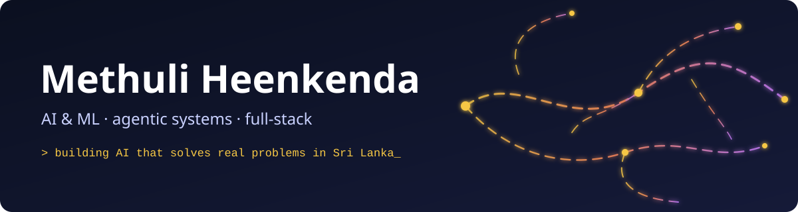

  
  
  

Second-year **AI & Data Science** undergrad at IIT (with Robert Gordon University, UK) in Colombo. I build agentic AI, ML pipelines and full-stack apps, usually for problems close to home: farmers, dementia carers, car buyers, and low-resource languages. Currently looking for a **software or AI engineering internship**.

---

## `[01]` highlights

- 🥇 **Top 12 Finalist, WiE HackElite** (University of Moratuwa) for GoviHitha
- 🎯 **Finalist, J'Extreme** (University of Sri Jayewardenepura)
- 🚀 **Cursor Buildathon**: Recall, a voice AI companion for dementia patients, drew interest from a venture capital firm
- 💼 Freelance engineer shipping real client apps (QR-code attendance app for the Institute of Valuers of Sri Lanka, delivered as an Android APK)

## `[02]` featured projects

<table>
  <tr>
    <td width="50%" valign="top">
      <h3><a href="https://github.com/methuliH/GoviHitha">🌾 GoviHitha</a></h3>
      Snap a photo of a sick crop and get a diagnosis, weather risk and local remedies with prices. Parallel Google ADK agents return full advice in under 30 seconds.  
      <code>Python</code> <code>Google ADK</code> <code>Gemini Vision</code> <code>Next.js</code> 
      <a href="https://govi-hitha.vercel.app">Live demo →</a>
    </td>
    <td width="50%" valign="top">
      <h3><a href="https://github.com/methuliH/PriceLens">🚗 PriceLens</a></h3>
      Scraped 3,500+ listings and trained an XGBoost model to price used cars in Sri Lanka, with a SHAP explanation for every estimate.  
      <code>XGBoost</code> <code>SHAP</code> <code>FastAPI</code> <code>MongoDB</code>
    </td>
  </tr>
  <tr>
    <td width="50%" valign="top">
      <h3><a href="https://github.com/methuliH/multilingual-circuits-si-ta">🔬 Multilingual Circuits</a></h3>
      Do small LLMs think in a shared concept space across languages? Tracing circuits in Gemma-2-2B, working towards Sinhala and Tamil.  
      <code>Interpretability</code> <code>Gemma-2</code> <code>Jupyter</code>
    </td>
    <td width="50%" valign="top">
      <h3><a href="https://github.com/methuliH/recall">🧠 Recall</a></h3>
      A real-time voice companion with a lip-synced avatar that talks with dementia patients using their memory book and sends caregivers session summaries.  
      <code>LiveKit</code> <code>Gemini</code> <code>Next.js</code> <code>TypeScript</code>
    </td>
  </tr>
  <tr>
    <td width="50%" valign="top">
      <h3><a href="https://github.com/methuliH/adaptive-learning-mvp">📈 Adaptive Learning MVP</a></h3>
      Bayesian Knowledge Tracing engine that estimates student mastery and serves the next question at the right difficulty.  
      <code>Go</code> <code>Gin</code> <code>pyBKT</code>
    </td>
    <td width="50%" valign="top">
      <h3><a href="https://github.com/methuliH/clinical-trial-matcher">🏥 Clinical Trial Matcher</a></h3>
      MCP server that reads a FHIR patient record, finds ClinicalTrials.gov studies and explains eligibility criterion by criterion.  
      <code>FastMCP</code> <code>FHIR</code> <code>Python</code>
    </td>
  </tr>
</table>

More: [figma-fit](https://github.com/methuliH/figma-fit) (MCP server that keeps Figma data inside your token budget) · [physarum-bloom-simulation](https://github.com/methuliH/physarum-bloom-simulation) (slime-mold agents that grow flowers) · [little-dude](https://github.com/methuliH/little-dude) (a tiny AI buddy that lives on your Windows desktop)

## `[03]` toolbox

**AI/ML:** Google ADK · Gemini · Claude API · MCP · LiveKit · XGBoost · SHAP · pandas · NumPy

## `[04]` right now
- 🔭 Exploring how language models represent Sinhala and Tamil
- 🛠️ Freelance work: a web-based Ayurvedic plant reference for a client
- 🎤 Vice President PR at IIT Toastmasters, Event Director at the Mozilla Campus Club

## `[05]` off the keyboard
First violinist with the National Youth Orchestra of Sri Lanka, and I like making slime mold grow flowers in code.

Colombo, Sri Lanka · <a href="mailto:methuli.thinara@gmail.com">methuli.thinara@gmail.com</a>

